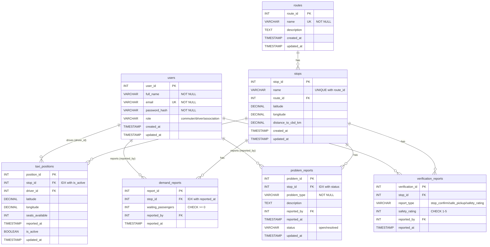

# Eyabantu Taxi Program - BFB 321 Group 05

## Project Description
Eyabantu ("for the people") is a web application that brings real-time visibility to South Africa's minibus taxi industry, which carries 65-75% of the country's public transport users.

- **Commuters** can see where taxis stop on 6 pilot routes into Pretoria CBD, when the next taxi will arrive, and which problems have been reported at taxi ranks.
- **Drivers and taxi associations** can see where passenger demand is highest, check taxis in and out at stops, and see how many spare taxis to send where.
- **Taxi associations** can mark problems at ranks as resolved.
- **Everyone** can report stops, safe pickups and how safe they felt, which is how stops get verified.

Stops are verified by combining driver check-ins and commuter reports. The website includes an SOS button that calls the police (10111) for commuters who feel unsafe.

*BFB 321 Supply Chain Web Application - Final Project. Built with Python (Flask), MySQL, HTML and CSS. This builds on our semester project (frontend and supply chain model) by adding a MySQL database, a REST API, logins and live data on every page.*

## Group 05 Members
| **Name**          | **Student Number** | **GitHub username** |
|-------------------|--------------------|---------------------|
| Danie Smit        | u23596717          | [u23596717-Danie-Smit](https://github.com/u23596717-Danie-Smit) |
| Harley Dalmeida   | u22717227          | [u22717227](https://github.com/u22717227) |
| Jaco Grobbelaar   | u23535173          | [jaco-06](https://github.com/jaco-06) |

## Installation and Setup

### What you need
- **Python 3.10 or newer**: download from python.org (on Windows, tick "Add Python to PATH" during install)
- **MySQL Server 8 and MySQL Workbench**: download the MySQL Installer from dev.mysql.com and remember the root password you choose
- **A web browser**: Chrome, Edge, Firefox or Safari
- **VS Code** (recommended)
- **Git** (only needed to clone from GitHub)

### Step 1: Get the project
Either clone it from GitHub:
```
git clone https://github.com/u22717227/BFB321_group_05.git
cd BFB321_group_05
```
or download the zip from GitHub (**Code > Download ZIP**), **right-click it and choose "Extract All"**, and open the extracted folder.

### Step 2: Open it in VS Code
**File > Open Folder** and choose the project folder (the one containing `app.py`, `templates` and `static`).

### Step 3: Set up Python and install the packages
Open a terminal in VS Code (**Terminal > New Terminal**) and run:

**Windows**
```
py -m venv venv
venv\Scripts\activate
py -m pip install -r requirements.txt
```

**Ubuntu / Linux / Mac**
```
python3 -m venv venv
source venv/bin/activate
pip install -r requirements.txt
```

### Step 4: Create your .env file
```
copy .env.example .env      # Windows
cp .env.example .env        # Ubuntu / Linux / Mac
```
Open `.env` and set `DB_USER` and `DB_PASSWORD` to your MySQL login (usually `root` and the password you use in MySQL Workbench). The real `.env` is in `.gitignore`, so your password never goes to GitHub.

### Step 5: Create the database and load the sample data
In MySQL Workbench, open `schema.sql` and click the lightning bolt, then open `seed.sql` and click the lightning bolt. Always run `schema.sql` first.

Or use one command in the terminal:
```
mysql -u root -p -e "source schema.sql; source seed.sql"
```
Running both files again resets the database to the sample data.

### Step 6: Run the supply chain model tests
```
py -m pytest            # Windows
python3 -m pytest       # Ubuntu / Linux / Mac
```
All 11 tests should pass.

### Step 7: Run the website
```
py app.py               # Windows
python3 app.py          # Ubuntu / Linux / Mac
```
Open **http://127.0.0.1:5000** in your browser. The home page should show 7 taxi stops and 14.3% stops verified. Keep the terminal open while you use the website.

### Demo accounts
All three accounts use the password `demo123`.

| Email | Role | Can do |
|---|---|---|
| `commuter@eyabantu.co.za` | Commuter | View stops and demand, report demand, problems and stops |
| `driver@eyabantu.co.za` | Driver | Everything a commuter can, plus taxi check-in and check-out |
| `assoc@eyabantu.co.za` | Taxi association | Everything a driver can, plus resolve problems |

## Team Contributions

### Danie Smit (u23596717)
- Updated the supply chain model with the heat map levels, deployment plan and edge cases such as people waiting with no taxis (supply_chain_model.py)
- Worked out the 8 home-page KPIs
- Wrote the pytest tests (tests/test_supply_chain_model.py)
- Drew the ERD from the schema (docs/erd.png)
- Wrote the README

### Harley Dalmeida (u22717227)
- Set up the Flask app, error handling and logging (app.py)
- Added role-based login for commuters, drivers and taxi associations
- Connected the app to MySQL (config.py, db.py, .env.example)
- Designed the database and sample data (schema.sql, seed.sql)
- Wrote all the database queries (models.py)
- Built the REST API with 16 endpoints (routes/api.py)

### Jaco Grobbelaar (u23535173)
- Updated the page templates for live data: welcome, live stops, demand, report and login (templates/)
- Added the shared base template with navigation and green/red messages (base.html)
- Updated the shared stylesheet (style.css)
- Wrote the page routes (routes/pages.py)
- Built the forms for demand reports, problem reports, resolving problems and taxi check-in and check-out

## Project Purpose

The minibus taxi industry carries 65% to 75% of South Africa's public transport users, which is about 15 million trips a day across roughly 200 000 to 283 000 taxis. The industry generates around R90 billion a year and employs about 300 000 drivers and 100 000 marshals. It works like a logistics network that moves commuters from residential areas to work, economic and educational destinations.

Despite its size, the industry is informal and unscheduled. Taxis leave only when full, there are no published routes or timetables, and vehicles are not tracked. Commuters wait long and unpredictable times at ranks that can feel unsafe, while drivers chase the same passengers in busy areas and struggle to find customers in off-peak times.

Eyabantu aims to improve customer fulfilment and fleet utilisation by sharing real-time information between commuters, drivers and taxi associations. It builds on existing tools such as TeksiMap and WhereIsMyTransport instead of replacing them.

### Impact Areas:
- **Social:** Shorter waiting times and safer, more predictable waiting at ranks and stops.
- **Economic:** Better use of seats and higher driver income, especially in off-peak hours.
- **Operational:** Route and demand data that associations and municipalities can use for fleet planning.

### Pilot Area
The sample data uses 6 Tshwane routes into Pretoria CBD:

| Route | Stops |
|---|---|
| Mamelodi - Pretoria CBD | Mamelodi Rank, Denneboom |
| Silverton - Pretoria CBD | Silverton |
| Soshanguve - Pretoria CBD | Soshanguve Rank |
| Atteridgeville - Pretoria CBD | Atteridgeville Rank |
| Mabopane - Pretoria CBD | Mabopane Station |
| Hammanskraal - Pretoria CBD | Hammanskraal Rank |

The numbers in the app come from this sample data, not from real commuters. Baseline waiting time, occupancy and demand still need to be measured on these routes before comparing against Eyabantu.

---

## Features

### Welcome Page (/)
- **Sticky header** with the Eyabantu logo on every page, links to Live stops, Demand and Report, and a Login / Logout link.
- **Hero section**: "Sawubona! Ride smarter with Eyabantu" next to a framed photo of minibus taxis.
- **Live KPI band** (yellow): 8 numbers calculated from the database every time the page loads (see the table below).
- **SOS block**: a red "Call Police 10111" button that dials straight from a phone.
- **"How will you use Eyabantu?"**: three blocks, one per user, each with its own button.
- **How it works** and **Pilot routes** sections.

| KPI | How it is calculated |
|---|---|
| Taxi stops | Number of stops in the database |
| Stops verified | Stops with a confidence of 0.5 or more, divided by all stops |
| Open problems | Problem reports that are still open |
| Active taxis | Taxis that are checked in |
| Under-served stops | Stops where demand intensity is above 1 |
| Average waiting passengers | Average of the latest waiting count at each stop |
| Forecast next demand | Exponential smoothing (alpha = 0.3) over the 8 newest demand reports |
| Average taxi occupancy | Average of (15 - seats available) / 15 over the active taxis |

### Commuter Features (/stops)
- **Next taxis table**: Stop, route, ETA and a confidence badge per stop.
- **Verified / Unverified badges**: Stops only show as verified once there is enough evidence (see the confidence score below).
- **Current problems at taxi ranks**: Open problems, newest first. Taxi associations see a "Resolve" button.
- **Report a problem**: Anyone can report a problem at a stop. It is saved to MySQL and shows in the table straight away.

### Driver & Association Features (/demand)
- **Driver check-in**: Drivers and associations check a taxi in at a stop with the number of free seats (0 to 15), and check it out again when it leaves.
- **Report waiting passengers**: Anyone can report how many people are waiting at a stop (0 to 1000).
- **Demand heat map**: Passengers waiting, taxis present, intensity and the demand level per stop: Very high, High, Moderate or Low.
- **Suggested deployment**: How many of the 20 spare taxis to send to each stop.

### Reporting Features (/report)
- **Report a stop or pickup**: Stop, report type and a 1-5 safety rating.
- **Report types**: Taxi stops here, I was picked up safely, I felt safe while waiting at this stop.

### Forms and Messages
Every form saves to MySQL, goes back to the same page and shows a green message when it worked or a red message that explains what to fix. Actions that need a login send you to the login page with a message.

| Action | Route | Login needed |
|---|---|---|
| Report waiting passengers | `POST /demand/report` | No |
| Report a problem | `POST /problems/report` | No |
| Resolve a problem | `POST /problems/<id>/resolve` | Association |
| Taxi check-in | `POST /taxis/checkin` | Driver or association |
| Taxi check-out | `POST /taxis/<id>/checkout` | Driver or association |
| Submit a stop report | `POST /report` | No |

### Supply Chain Model (supply_chain_model.py)
A standalone Python module with no Flask or database code. Each function has a docstring with its formula. The pages and the API both use this file, so they always give the same answers.

| Function | Formula |
|---|---|
| `eta_minutes()` | ETA = d / v x 60 + stops ahead x 1.5 min dwell (v = 30 km/h) |
| `expected_wait()` | Average wait = headway / 2 |
| `occupancy_percentage()` | Passengers / seats (15) x 100 |
| `confidence_score()` | (stop confirmations + 2 x driver check-ins) / 10, capped at 0.5 if under 3 pieces of evidence |
| `forecast_demand()` | Exponential smoothing: F = a x A + (1 - a) x F, with a = 0.3 |
| `demand_intensity()` | Passengers waiting / (taxis present x 15 seats). Above 1 = under-served |
| `demand_level()` | Above 3 = Very high, 1.1 to 3 = High, 0.8 to 1.1 = Moderate, below 0.8 = Low |
| `deploy_taxis()` | Send each spare taxi to the stop with the largest seat shortfall |
| `heat_map_entry()` | Intensity and level for one stop. People waiting with no taxis = Very high |

### Database (schema.sql)
Seven related MySQL tables with primary keys, foreign keys, CHECK rules, `created_at` / `updated_at` fields and indexes.



| Table | What it stores |
|---|---|
| `users` | Commuters, drivers and taxi associations, with hashed passwords |
| `routes` | The 6 pilot routes into Pretoria CBD |
| `stops` | Taxi stops with their route, distance to the CBD and coordinates |
| `taxi_positions` | Driver check-ins (`seats_available`, `is_active`) |
| `demand_reports` | How many passengers are waiting at a stop |
| `problem_reports` | Problems at ranks, `open` or `resolved` |
| `verification_reports` | Stop confirmations, safe pickups and safety ratings |

Indexes: `(stop_id, is_active)` on `taxi_positions`, `(stop_id, reported_at)` on `demand_reports` and `(stop_id, status)` on `problem_reports`.

### REST API (routes/api.py)
All endpoints are under `/api` and return JSON. Lists use `page` and `size` (max 50).

| Method | Path | What it does |
|---|---|---|
| GET | `/api/stops?route_id=&page=&size=` | List stops, with an optional route filter |
| GET | `/api/stops/<id>` | One stop with its ETA and confidence |
| POST | `/api/stops` | Add a stop (`name` is required) |
| PATCH | `/api/stops/<id>` | Change a stop's name or distance to the CBD |
| GET | `/api/demand-reports?stop_id=&page=&size=` | List demand reports, newest first |
| GET | `/api/demand-reports/<id>` | One demand report |
| POST | `/api/demand-reports` | Report waiting passengers |
| GET | `/api/heatmap` | Heat map data with intensity and level per stop |
| GET | `/api/taxi-positions?active=&stop_id=` | List taxi check-ins (only active ones unless `active=false`) |
| GET | `/api/taxi-positions/<id>` | One taxi check-in |
| POST | `/api/taxi-positions` | Check a taxi in |
| PATCH | `/api/taxi-positions/<id>` | Check a taxi out or back in (`{"is_active": false}`) |
| GET | `/api/problems?status=open&page=&size=` | List problems, filtered by `open` or `resolved` |
| GET | `/api/problems/<id>` | One problem |
| POST | `/api/problems` | Report a problem |
| PATCH | `/api/problems/<id>` | Resolve or reopen a problem |

Example:
```
POST /api/demand-reports
{"stop_id": 1, "waiting_passengers": 40}

201 Created
{"report_id": 4}
```

Errors come back as `{"error": "message"}`:

| Status | When |
|---|---|
| 400 Bad Request | A field is missing or wrong, for example `waiting_passengers` outside 0 to 1000 or `seats_available` outside 0 to 15 |
| 404 Not Found | The stop, problem or taxi check-in does not exist |
| 409 Conflict | Duplicate data, for example two stops with the same name on one route |
| 500 Internal Server Error | Something unexpected went wrong. The change is rolled back and the error is written to `eyabantu.log` |

### Testing (tests/test_supply_chain_model.py)
- 11 pytest tests check the model formulas, for example that 30 km at 60 km/h gives an ETA of 30 minutes.
- Edge cases are tested too: no taxis and nobody waiting is Low, and people waiting with no taxis is Very high.
- To test the website itself: log in as `assoc@eyabantu.co.za`, resolve the open problem, report demand, check a taxi in and out, and submit a stop report. Each one should show a green message and change the numbers.

### Backup and Reset
```
mysqldump -u root -p eyabantu > backup.sql
mysql -u root -p eyabantu -e "source backup.sql"
```
To go back to the sample data, run `schema.sql` and then `seed.sql` again.

### Configuration (.env)
| Setting | What it is for |
|---|---|
| `APP_ENV` | `development`, `testing` or `production` (production turns debug off) |
| `SECRET_KEY` | Signs the login sessions |
| `DB_HOST`, `DB_PORT` | Where MySQL runs (default `localhost` and `3306`) |
| `DB_USER`, `DB_PASSWORD` | Your MySQL login |
| `DB_NAME` | The database name (`eyabantu`) |

### Limitations and Next Steps
- The app runs locally and is not hosted online yet.
- ETA uses a fixed average speed of 30 km/h instead of real GPS.
- The numbers come from sample data, so the next step is a pilot on one real route to measure waiting times before and after.

---

## Folder Structure
```
BFB321_group_05/
|-- app.py                       # starts the app: config, logging, error pages
|-- config.py                    # settings read from .env
|-- db.py                        # one MySQL connection per request
|-- models.py                    # all the SQL queries
|-- supply_chain_model.py        # the supply chain model
|-- schema.sql                   # creates the database and tables
|-- seed.sql                     # sample data and demo accounts
|-- requirements.txt
|-- pytest.ini
|-- .env.example                 # copy this to .env
|-- .gitignore
|-- README.md
|-- routes/
|   |-- __init__.py
|   |-- pages.py                 # pages, forms and login
|   `-- api.py                   # REST API
|-- templates/
|   |-- base.html                # header, navigation and messages
|   |-- index.html               # welcome page with live KPIs
|   |-- stops.html               # commuter: live stops and problems
|   |-- demand.html              # drivers/associations: check-in and heat map
|   |-- report.html              # report a stop
|   `-- login.html
|-- static/
|   |-- style.css                # shared styles
|   `-- taxis.jpg                # welcome page photo
|-- docs/
|   |-- erd.png                  # ERD
|   `-- erd.mmd                  # ERD source
`-- tests/
    `-- test_supply_chain_model.py
```
